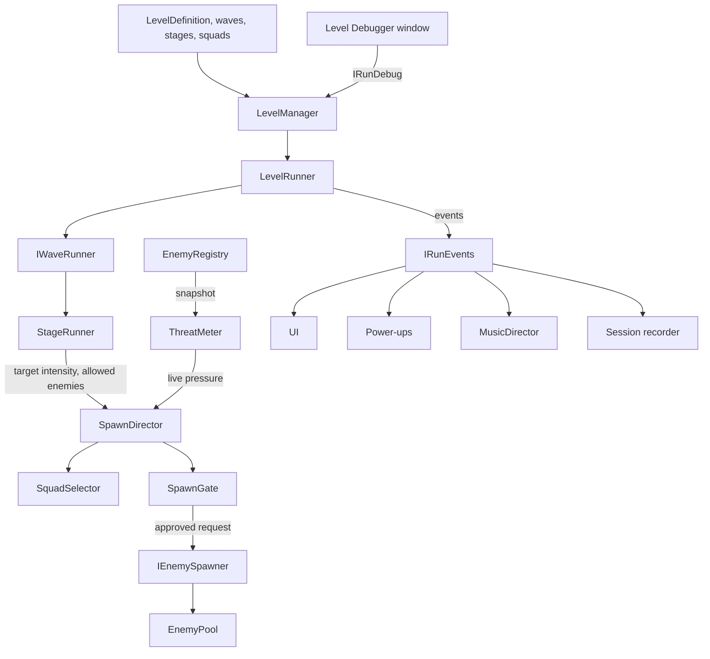

# Game Director: design

Status: **proposal, version 3.1** (2026-11-25). Nothing here is built yet. Open decisions are in section 12.
Versions 2 and 3 are kept in `Docs/CaseStudies/GameDirector/history/`. Version 3.1 adds section 5b (space). The reasons behind each change are in
`Docs/CaseStudies/GameDirector/decision-log.md`.

What changed from version 2:
- A level is now **Level → Waves → Stages**. The stage is the smallest thing you design.
- The old build-up / peak / relax *cycle* is gone. A rest or a peak is simply a **stage with that role**.
- The old "wave card" (a group of enemies bought in one go) is renamed **squad**, because "wave" now means a part of a level.
- Each wave and stage says **which enemies are allowed**, and one gate enforces it.
- Wave **types** can be added later (boss) without touching the existing ones.
- Authoring and debugging are **two separate windows**.
- Music is planned as a listener of the director's events.

The threat model from version 2 (wave threat and live pressure) is kept. It is summarised in section 5.

**Built so far (2026-11-25):** steps 1 and 2 of section 11. Stages have a role, curve, duration, max duration and the end rules
*Time up*, *All cleared* and *Time up, then cleared*. The debugger has skip, finish, restart, jump, fail, pause, clear enemies
and game speed. Everything else in this document is still a plan. If the last stage is removed or stages are reordered during
Play, it takes effect when the wave or run starts again.

---

## 1. The words

| Word | Meaning | Example |
|---|---|---|
| **Level** | The whole run: waves in order | Level 1, about 10 minutes |
| **Wave** | A chapter of the level. Has a *type* | "Mines introduced" (standard), "Boss" (boss) |
| **Stage** | A part of a wave. **Smallest unit you design** | "Warm-up", "Build-up", "Peak", "Rest" |
| **Squad** | One group of one enemy type in one formation, bought in one go | 12 Bombers in a wave queue |

```
Level 1
 ├─ Wave 1  "First contact"     (standard)   roster: Drifter, Chaser
 │   ├─ Stage  Warm-up
 │   ├─ Stage  Build-up
 │   ├─ Stage  Peak
 │   └─ Stage  Rest
 ├─ Wave 2  "Minefield"         (standard)   roster: Chaser, Bomber
 │   ├─ Stage  Build-up         allowed: Bomber only      <- introduces the mine on its own
 │   ├─ Stage  Peak             allowed: (whole roster)
 │   └─ Stage  Rest
 └─ Wave 3  "Boss"              (boss, later)
```

**Why stages help intensity.** Version 2 drew one curve and laid a repeating cycle on top, so a peak and a rest were
side effects of a setting. Now each one is something you place, time, fill and test on its own. Each stage has its own
short intensity curve, and together they form the level's intensity line.

---

## 2. What a stage holds

| Setting | Meaning |
|---|---|
| Name and **role** | Warm-up, Build-up, Peak, Rest. The role also tells music and power-ups what kind of moment this is |
| Intensity curve | 0 to 1, over the stage's length |
| **End rule** | *Time up* · *All cleared* · *Kill count* · *Time up, then cleared* |
| Duration / max duration | Max duration is a safety limit, so a stage waiting for a clear can never hang the level |
| **Allowed enemies** | Empty = the wave's whole roster. Otherwise a smaller list |
| Opening squads | Spawned for certain when the stage starts (to introduce an enemy) |
| Squad pool | What the director may choose from after that |
| Carry-over | What happens to enemies still alive from the previous stage: *keep* · *wait until cleared* · *remove* |
| Signals | Events at the start, at a time, or at the end (`PowerUpDrop`...) |

## 3. Keeping the wrong enemies out

Final allowed list = the wave's roster, narrowed by the stage's list.

It is checked in two places for two different reasons:
1. **While you design:** the Level Designer marks a squad red if its enemy isn't allowed in that stage.
2. **While the game runs:** every spawn request passes one **`SpawnGate`**: allowed enemy? under the type's cap? under the
   total cap? Nothing can spawn without it, so a mistake elsewhere can't let an enemy through.

The roster controls what may *spawn*, not what may *still be alive*. A Bomber that survives into a stage without Bombers
is a carry-over question, which is why stages have that setting.

The debug window may ask to ignore the roster (to test an enemy anywhere). That is an explicit flag on the request and is
marked in the log, never a way around the gate. Performance caps can't be ignored.

---

## 4. Classes

Only **one** of the three "managers" is a MonoBehaviour. Waves and stages are plain C# objects that it ticks. Reasons: one
clear update order, unit tests without Unity, and the simulator can run a full level without Play mode.

### Game.Core (plain C#, tested)

| Class | One job |
|---|---|
| `LevelRunner` | Runs waves in order. Skip, restart, jump. Raises run events |
| `IWaveRunner` | What every wave type can do: begin, tick, skip, finish |
| `StagedWaveRunner` | The standard wave: runs stages in order |
| `BossWaveRunner` *(later)* | Ends when the boss dies |
| `StageRunner` | One stage: time, intensity curve, end rule, signals |
| `IStageEndRule` | One class per end rule |
| `SpawnDirector` | Decides *when* and *what* to spawn: compares target with pressure, asks the selector |
| `SquadSelector` | Filters squads and makes the weighted random pick, with variety |
| `SpawnGate` | Final check on every request (section 3) |
| `ThreatMeter` | Live pressure from a snapshot of enemies |
| `ThreatEstimator` | Predicted threat of a squad before it spawns |
| `PlayerHeat` | How the player is doing, smoothed |
| `SeededRandom` | The run's own random numbers |
| `MusicStateSelector` | Which music state we should be in (section 9) |

### Game.Runtime (Unity)

| Class | One job |
|---|---|
| `LevelManager` (MonoBehaviour) | Builds the runner from assets, ticks it, forwards requests, publishes events. Registered in `GameInstaller` |
| `EnemySpawner` : `IEnemySpawner` | Places a squad using a spawn zone and activates it |
| `EnemyPool` | One pool per enemy prefab, filled before play |
| `EnemyRegistry` | Who is alive, of what type, in formation or charging. Fills the snapshot |
| `PlayerPerformance` | Kills, hits, lives; later the multiplier |
| `MusicDirector`, `MusicPlayer` *(later)* | Section 9 |

Already built and reused: `FormationMotion`, `FormationDefinition`, `IFormationMember` (added with the Bomber, so the
spawner doesn't need to know enemy types), `ObjectPool<T>`.

### Assets (`Assets/Tuning/Director/`)

| Asset | Holds |
|---|---|
| `LevelDefinition` | Ordered waves, peak threat, caps |
| `WaveDefinition` (abstract) | Name, roster. Subtypes below |
| → `StandardWaveDefinition` | Stages |
| → `BossWaveDefinition` *(later)* | Boss, its own settings |
| `StageDefinition` | Section 2. Its own asset, so a good Rest stage can be reused |
| `SquadDefinition` | Enemy, formations, zones, count range, intensity window, cooldown, weight |
| `EnemyDefinition` | Prefab, threat, cap, prewarm count |
| `ThreatModel` | Factors and curves |
| `DifficultyProfile` | Multipliers for Easy, Normal, Hard |
| `DirectorSignal` | A named moment |
| `MusicProfile` *(later)* | Section 9 |

### How they connect



### Adding a wave type later (the boss)

`WaveDefinition` has one method: *create your runner*. `LevelRunner` only knows `IWaveRunner`. So a boss wave is two new
classes (`BossWaveDefinition`, `BossWaveRunner`) and no edits to the standard wave. This is the Strategy pattern (same
interface, interchangeable behaviour) together with a factory method (the asset creates its own runner).

---

## 5. How intensity decides spawns

```
target   = stage intensity (with player heat) x level peak threat x difficulty
room     = target - live pressure - squads already on their way
spawn    = an allowed squad whose predicted threat fits in the room
```

- **Predicted threat** = count × enemy threat × formation factor × spawn zone factor.
- **Live pressure** counts each enemy by type, distance, and whether it is charging, then bends upward for crowding and
  adds for mixed types.

The factors and example values are in version 2, section 3. **They are guesses until playtests**, and the session recorder
exists to replace them with evidence.

## 5b. Space: where enemies go (built after the first playable level)

Measured 2026-11-25: the arena is 377 m around and 12 m tall. The normal camera (44 degrees, 22 m away, 16:9) sees about 36 m of
it, roughly a tenth. The ship flies 22 m/s around (17 s a lap) and 12 m/s vertically.

**Cells.** Four regions would be 94 m each, more than two and a half screens, so too coarse to shape what the player sees.
Proposed: about **12 sectors** (31 m, roughly a screen) x **3 height lanes** (4 m) = 36 cells, both numbers tunable. Cells
wrap at the seam.

**`ArenaGrid`** (Core) keeps two values per cell: enemy pressure now, and how long the player has recently spent there (fading).
**`SpawnPlacer`** (Core) scores the allowed spawn places, and the seed picks among the best:
- Lower score if the cell is already crowded or another squad has reserved it.
- Higher score, up to a cap, for lanes the player keeps using, so staying in two lanes stops being safe.
- Refused if it would block the last open route.

**Open route rule.** At least one lane stays passable ahead of the player on one side. The open lane should move over time,
otherwise it becomes the new safe spot. A stage can switch this rule off, for a deliberate trap.

**Overlap** has three causes and three fixes:
1. *Inside a formation:* spacing smaller than the enemy. The Level Designer warns per enemy and formation pair.
2. *Between squads:* cells are reserved while a squad arrives.
3. *After breaking off:* Chasers all steer to the same point. A small separation push keeps them apart, using the grid to look
   only at neighbours.

---

## 6. Level Designer window (edit time)

**Cylinder Shooter > Level Designer**

- Tree on the left: level → waves → stages. Drag to reorder, duplicate, disable.
- Timeline on top: stages as blocks coloured by role, with the combined intensity line and the expected length.
- Inspector on the right for whatever is selected, with the stage's curve and an *enemy × stage* grid of checkboxes.
- Warnings: squad not allowed here, empty pool, squad that never fits the room, stage with no way to end, level length off target.
- Simulate: run the whole level for several seeds and draw the result.

## 7. Level Debugger window (Play mode only)

**Cylinder Shooter > Debug > Level Debugger**. Yes, an EditorWindow works during Play mode and can control the running game.

| Control | What it does |
|---|---|
| **Skip stage / wave** | Removes enemies and moves on. Ends as `Skipped`: no rewards |
| **Finish stage / wave** | Ends it as if the player had done it: `Completed`, so rewards and music run as normal |
| Fail run | Ends the run as `Failed` |
| Restart stage, jump to any stage | With the same seed or a new one |
| Pause spawning, clear enemies | |
| Spawn a squad now | Optionally ignoring the roster |
| Override intensity | A slider in place of the curve |
| Invincible, time scale | |
| Copy seed, replay seed | |

**Skip and Finish are deliberately different.** Skip gets you somewhere; Finish tests what happens at the end. Every
end-of-stage event carries its reason, so score, power-ups and recorded sessions never count a skipped stage as beaten.

It also shows, live: the current level / wave / stage, time left, target against live pressure, enemies per type, why the
last spawn was refused, and the music state.

How it is wired:
- The window lives in `Game.Editor`. It talks only to **`IRunDebug`**, never to the runners directly.
- `IRunDebug` is implemented under `UNITY_EDITOR || DEVELOPMENT_BUILD`, so a release build has no cheats in it.
- A development build has no editor windows, so a small in-game panel can use the same interface there later.

**Careful with live tuning.** Asset edits made in Play mode are kept. That is useful, but a quick experiment can also
overwrite a tuned level. The window takes a snapshot when Play starts and offers *Keep* or *Revert* when it stops.
Values (curves, weights, caps) apply at once; structure (adding or reordering stages) applies from the next stage.

---

## 8. Events

`IRunEvents`, registered by `GameInstaller`:

`RunStarted` · `WaveStarted` · `WaveEnded(reason)` · `StageStarted(role)` · `StageEnded(reason)` · `SquadSpawned` ·
`PressureChanged(band)` · `Signal` · `RunEnded(reason)`

`PressureChanged` fires only when the band (calm, busy, intense) changes, not every frame.

---

## 9. Music (planned, built later)

Music listens to the events. The director doesn't know music exists.

**Choosing the state.** States: WarmUp, Combat, Intense, Rest, Boss, Ended.
- The stage's role sets the base state, so music matches what you designed.
- Live pressure can lift Combat to Intense when a moment turns out harder than planned.

**Not flickering.** Pressure moves constantly, so without protection the music would switch back and forth:
- *Two thresholds:* go to Intense above 0.75, come back only below 0.55 (called hysteresis).
- *Minimum hold:* stay in a state for at least 8 s or so.
- Boss and Ended override both.

**Sounding right.**
- Switch on the next bar, not at once. Schedule against `AudioSettings.dspTime` (the audio clock), because frame time drifts.
- Two audio sources, already in the prefab: one fades out while the other fades in.
- Tracks share a tempo and key, or a short transition clip sits between them.
- Later option: layers of one track (drums, bass, lead) that fade in with intensity. Smoother, but needs music made that way.

Classes: `MusicStateSelector` (Core, tested), `MusicDirector` (listens and chooses), `IMusicPlayer` / `MusicPlayer` (plays and
fades), `MusicProfile` (clips, tempo, bars, thresholds, fade times). Built-in Unity audio with an AudioMixer is enough to
start. All music must be original or properly licensed, since the repository is public.

---

## 10. Repeatable levels that still feel different

Same as version 2: a level asset plus a difficulty asset is the "baked" level, and a **seed** per run varies which squads are
picked, their formation, count, side and position. Rosters, stage order and intensity curves don't vary. The same seed
replays the same *choices*, but not an identical fight, because the player's actions change the pressure.

---

## 11. Build order

1. **Level, wave and stage runners** (no spawning yet) with tests, and the assets. You can watch a level progress.
2. **Level Debugger** with skip, finish, jump. Early on purpose: it makes every later step faster to test.
3. **EnemyPool, EnemySpawner, SpawnGate.** Enemies appear, rosters enforced.
4. **Threat model and SpawnDirector.** The level follows its intensity. Formation spacing warnings and Chaser separation here.
5. **Level Designer** timeline and warnings.
6. **Session recorder**, then the simulator.
7. **ArenaGrid and SpawnPlacer** (section 5b), once recordings show how players really move.
8. **Music.**
9. **Boss wave**, as the proof that a new wave type needs no changes elsewhere.

---

## 12. Open decisions (yours)

1. **Length:** should stages mostly end on time (predictable 10 minutes) or when cleared (rewards fast players, length varies)?
   Suggested: time for Build-up and Rest; *time up, then cleared* for Peak, with a max duration.
2. **Carry-over:** keep enemies between stages by default? Suggested: keep within a wave, clear before a new wave.
3. **Reuse:** stages as their own assets (reusable, more files) or stored inside the wave? Suggested: own assets.
4. **Death:** when the player dies mid-stage, does the stage continue, pause or restart?
5. **Between waves:** straight on, or a short pause for a title on the glass and a power-up?
6. **Debug in builds:** is the editor window enough for now? Suggested: yes.
7. Still open from version 2: heat strength, starting peak threat.
