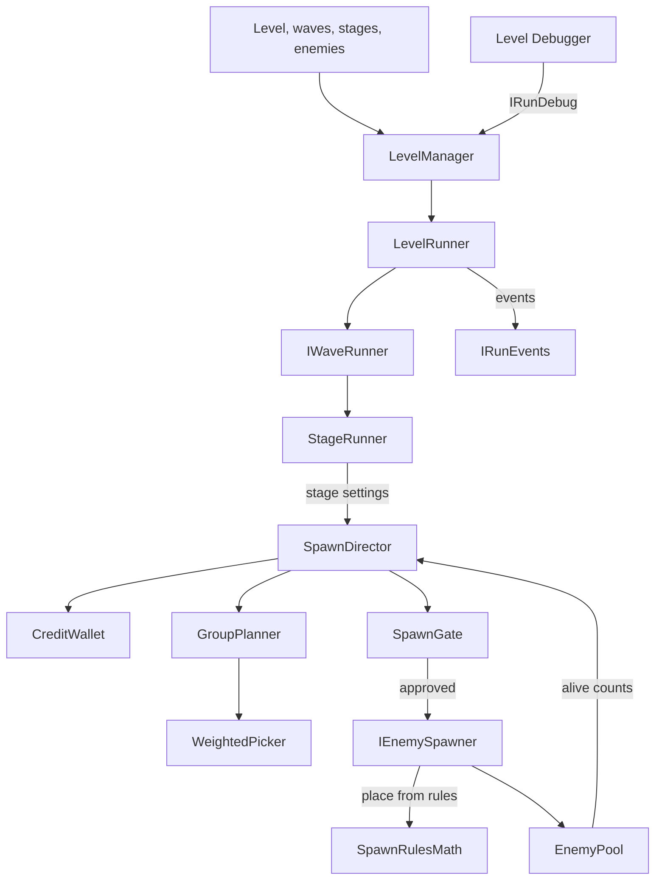

# Game Director: design

Status: **proposal, version 4** (2026-11-27). Steps 1 to 3 of the old build order are built; everything new in this
version is a plan. Open decisions are in section 13.
Older versions are kept in `Docs/CaseStudies/GameDirector/history/` (v2, v3, v3.1). The reasons behind each change are in
`Docs/CaseStudies/GameDirector/decision-log.md` (this version comes from entries 19, 20 and 21).

**The idea in one sentence:** the designer sets *how much pressure* a stage puts on the player and *which enemies* it may
use; the director decides *what, where, how many and when*, by itself, while the game runs.

What changed from version 3.1:
- **The director chooses.** No more scripted squads or hand-placed timelines. It earns **credits**, picks an enemy, a
  formation and a group size, saves up if it needs to, and spawns.
- **Cost is fixed per enemy** (how dangerous one of it is). A stage changes the **budget** (how much danger) and the
  **weights** (the mix). Owner's decision 21.
- **One enemy list per stage** (enemy, on, weight, max alive) replaces Allowed Enemies, the wave Roster and Scripted Squads.
- **Saving is a setting.** Calm-then-burst or a steady trickle is tuned per stage.
- **Spawn positions are rules relative to the player,** worked out at runtime. Each enemy says how far away it spawns
  (just off-screen, or far for an expensive enemy such as a boss).
- **Removed:** stage *Role*, the stage *Intensity* curve, the wave *Roster*, *Allowed Enemies*, *Scripted Squads*,
  `SquadDefinition`, `SquadScheduler`. They either did nothing in gameplay (Role, curve) or repeated each other.
- **Set aside, not thrown away:** the threat model of version 2 (predicted threat and live pressure) and the arena regions
  (5b of v3.1). Both wait for playtest evidence. Section 12 says how they would plug in.

---

## 1. The words

| Word | Meaning | Example |
|---|---|---|
| **Level** | The whole run: waves in order | Level 1, about 10 minutes |
| **Wave** | A chapter of the level. Has a *type* | "First contact" (standard), "Boss" (later) |
| **Stage** | A part of a wave. **The smallest thing you design** | a quiet opening, a peak, a rest |
| **Credits** | What the director earns over time and spends on enemies | 4 credits per second, saved up to 40 |
| **Cost** | Credits for **one** enemy of a type. Fixed for the whole game | Chaser 1, Bomber 2, a boss 50 |
| **Weight** | How likely an enemy is to be picked, compared with the others in the stage | Chaser 3, Bomber 1 → about 75% / 25% |
| **Group** | One formation of one enemy type, bought in one go | 12 Bombers in a wave queue = 24 credits |
| **Plan** | The group the director has decided to buy next, and is saving for | "next: 12 Bombers, Wave Queue" |

"Squad" from version 3 is now "group", and nobody designs one by hand any more: the director puts it together.

```
Level 1                                         max alive 150
 ├─ Wave 1 "First contact"
 │   ├─ Stage  Opening    2 cr/s   Chaser ✔ 3            30 alive
 │   ├─ Stage  Build-up   5 cr/s   Chaser ✔ 3  Bomber ✔ 1
 │   ├─ Stage  Peak      10 cr/s   Chaser ✔ 3  Bomber ✔ 2   140 alive
 │   └─ Stage  Rest       1 cr/s   Chaser ✔ 1
 └─ Wave 2 "Boss" (later)
```

The names "Opening", "Peak" and "Rest" are just names now. What makes a stage a peak is its numbers.

---

## 2. What the designer sets

### On each enemy (`EnemyDefinition`, set once)

| Setting | Meaning | Example |
|---|---|---|
| Prefab, Max alive, Prewarm | As today | |
| **Cost** | Credits for one of this enemy. How dangerous one is | Chaser 1, Bomber 2 |
| **Spawn distance** | *Just off-screen* · *Far* · *Custom* (metres along the ring) | Chaser: just off-screen. Boss: far |
| **Formations** | The formations this enemy may fly in, each with a **min** and **max** count and a weight | Chaser: Wave Queue 6–20, Line 5–12, Grid 9–25 |
| Lanes *(optional)* | Height lanes this enemy may spawn in, if it should be narrower than the stage's | Bomber: middle only |

Why formations live on the enemy: "a Bomber can fly in a wave queue but not a grid" is a fact about the Bomber, true in
every stage. Putting it on the enemy means it is set once.

### On each stage (`StageDefinition`)

| Group | Setting | Meaning |
|---|---|---|
| End | **Ends when** | *Timer* or *Timer, then all dead* (section 6) |
| | Length | Seconds of spawning |
| | Give up after | Only for *then all dead*: a safety limit so the stage can never hang |
| Credits | **Starting credits** | Credits the stage opens with, so the first group can come at once |
| | **Credits per second** | How fast credits are earned: the "speed of saving" |
| | **Credit cap** | The most it can save |
| Spending | **Group size** | Slider, *small ↔ big*. Small buys as soon as it can; big saves for large groups (section 4) |
| | **Longest wait** | If saving for a plan takes longer than this, buy a smaller group instead |
| | Gap between groups | Minimum seconds between two spawns, so groups don't arrive in the same instant |
| Limits | **Max alive** | Enemies alive at once in this stage (under the level's hard cap) |
| Enemies | **The enemy list** | One row per enemy: *Enemy · On · Weight · Max alive* (section 3) |
| Where | Spawn rules *(optional)* | Override the level's spawn rules for this stage (section 5) |

### On the level (`LevelDefinition`)

| Setting | Meaning |
|---|---|
| Waves | In order |
| **Max enemies alive** | The hard cap for performance, 150 |
| Spawn rules | The default rules for where groups appear (section 5) |
| Variety | How much an enemy's chance drops right after it is picked, and how fast it recovers (section 3) |

### On a wave (`StandardWaveDefinition`)
Name and stages. The **Roster is removed**: the stages' enemy lists say everything.

---

## 3. The enemy list: on, weight, max alive

| Enemy | On | Weight | Max alive |
|---|---|---|---|
| Chaser | ✔ | 3 | 60 |
| Bomber | ✔ | 1 | 20 |
| Gunner | ✘ | – | – |

- **On** (the unlock toggle): whether this enemy may spawn in this stage. An enemy missing from the list, or switched off,
  can't spawn. Introducing a new enemy = switching it on in a later stage.
- **Weight:** chance of being picked compared with the others. Only enemies that are on, below their max alive, and able
  to fit at all are counted.
- **Max alive:** this enemy's limit in this stage. The enemy's own Max alive (performance) still applies on top.
- **Variety** (a level setting, not per row): right after an enemy is picked, its weight is multiplied by a *dip* (for
  example 0.3) that recovers over a few seconds. It stops the same enemy being picked three times in a row without
  forbidding it. The same applies to the formation choice.

The list is the only place that says what may spawn. One gate checks it (section 7).

---

## 4. How the director decides

Every frame, in this order:

```
1. credits = min(cap, credits + credits per second × dt)
2. if there is no plan, make one:
     enemy     = weighted pick from the stage list (on, below max alive, with variety)
     formation = weighted pick from that enemy's formations
     count     = between the formation's min and max, pushed by the Group size slider, with a little randomness,
                 then reduced to fit max alive and the credit cap
     cost      = count × enemy cost
3. if credits ≥ plan cost, the gap since the last group has passed, the gate approves and a place is found:
     spawn the group, credits -= cost, forget the plan
4. else if we have waited longer than Longest wait:
     shrink the plan to what we can afford now (not below the formation's min), or pick again
```

**Saving is not a separate mode.** It happens because the director decides *what* to buy before it can afford it. With
Group size on *small*, plans are cheap and get bought straight away: a steady trickle. With Group size on *big*, plans
are large, the director waits, and the screen calms down before a big arrival. *Longest wait* stops a stage from going
quiet by accident.

**Worked example** (made-up numbers, to be tuned by playing):
Peak stage: 10 cr/s, cap 60, start 20, Group size big. The director plans 20 Chasers (20 credits) and buys them at once
with the starting credits. Next plan: 14 Bombers (28 credits) → about 2.8 s of saving → they arrive. Both enemies were
just picked, so variety has lowered both chances for a few seconds; whichever recovers first is more likely next. In the Rest stage at 1 cr/s, cap 10, Group size
small: a group of 5–6 Chasers every 5–6 s.

**What happens at max alive.** If the stage or the level is full, the plan waits. Credits keep coming in up to the cap,
so clearing a crowd can be followed straight away by a big group. That rewards clearing with a new challenge; the credit
cap decides how big. (Open decision 1.)

**The boss case.** A boss costing 50 in a stage with a cap of 40 can never be bought. That is a mistake the editor
warns about, not something that silently never happens.

---

## 5. Where groups appear

Positions are rules **relative to the player**, worked out at runtime. Points placed in the scene don't suit a world that
wraps around with a camera that follows the player.

**On the level (default) or a stage (override), a `SpawnRules` asset:**

| Rule | Options |
|---|---|
| Side | *Ahead* (where the ship is heading) · *Behind* · *Either* |
| Height lanes | Top, Middle, Bottom (any mix). The arena's 12 m are split into three 4 m lanes |
| Spacing between groups | Metres a new group's centre must keep from groups that are still arriving |
| Safe distance | Nothing ever spawns closer than this to the ship |

**On the enemy: Spawn distance.**
- *Just off-screen:* the first place past the edge of the screen on the chosen side (the existing hidden search).
  For Chasers and Bombers: they reach the player quickly and the fight keeps going.
- *Far:* about half a lap away, for expensive enemies, so the player has time to notice (later, an off-screen indicator
  and a music change).
- *Custom:* a distance in metres along the ring.

How a place is found: try the chosen side at the enemy's distance, in an allowed lane; reject it if the group would be
visible (for *just off-screen*), too close to the ship, or too close to another arriving group; widen the search a
little; if nothing fits, the plan waits a frame and tries again (logged as *no room*).

The rules are drawn as **gizmos** around the ship in the Scene view during Play: the off-screen bands, the far point,
lanes, and the last spawn.

**Movement is not the director's job.** The director decides *what* and *where*; `FormationMotion` and each enemy decide
*how they fly*. Splines or new flight patterns later are new formation types, not director changes.

---

## 6. How a stage ends

| Ends when | Fields shown | What happens |
|---|---|---|
| **Timer** | Length | The director spends for *Length* seconds, then the next stage starts. Enemies still alive stay |
| **Timer, then all dead** | Length, Give up after | The director spends for *Length* seconds, stops buying, then waits for every enemy to die. *Give up after* moves on anyway |

Version 3 also had *All cleared* on its own. With a director that keeps spending it needs a moment to stop buying, which
makes it the same as *Timer, then all dead*. Existing assets set to *All cleared* will be read as *Timer, then all dead*,
so nothing breaks.

"When enemies leave the screen" doesn't apply here: on a ring, nothing leaves.

---

## 7. Keeping the wrong enemies out

Every spawn request, including the debugger's, passes the **`SpawnGate`** (built in step 3):
1. the enemy is on in the stage's list (the debugger may ignore this, and the log says so);
2. under the enemy's max alive in this stage, and under its own performance cap;
3. under the stage's max alive and the level's hard cap of 150 (never ignored).

What changes from step 3: the gate's "allowed" question reads the stage list instead of roster and allowed enemies.

While designing, the inspector warns about: an enemy list with nothing on; an enemy that is on but has no formations; a
formation whose *min* group costs more than the credit cap; Max alive lower than the smallest group; a stage with 0
credits per second and 0 starting credits.

---

## 8. Classes

### Kept as built

| Class | Change |
|---|---|
| `LevelRunner`, `IWaveRunner`, `StagedWaveRunner`, `StageRunner`, end rules | Stage settings lose Role and Intensity; end modes as section 6 |
| `SpawnGate` | Reads the stage list |
| `EnemyPool`, `EnemySpawner` | The spawner takes a count and a place from the director instead of a squad asset |
| `LevelManager`, `HazardBattlefield`, `GameInstaller` | Tick the director instead of the scheduler |
| Level Debugger, `IRunDebug`, `RunDebug`, tuning snapshot | New view of credits and the plan (section 9) |
| `FormationMotion`, `FormationDefinition`, `IFormationMember` | Formation needs a **count from outside**, instead of only its own `_count` |

### New

| Class | Assembly | One job |
|---|---|---|
| `CreditWallet` | Core | Earn, cap, spend. Tested |
| `WeightedPicker` | Core | Weighted random pick with the variety dip. Used for enemies and formations. Tested |
| `GroupPlanner` | Core | Makes a plan: enemy, formation, count, cost, from the stage settings. Tested |
| `SpawnDirector` | Core | The loop of section 4: plan, save, shrink, ask the gate, ask for a place. Tested without Unity |
| `SpawnRulesMath` | Core | Candidate angles and heights for side, lane, distance, spacing. Tested |
| `SpawnRules` | Runtime (SO) | Section 5 |
| `EnemyFormationOption` | Runtime (serializable) | Formation, min, max, weight |
| `StageEnemyEntry` | Runtime (serializable) | Enemy, on, weight, max alive |

### Removed
`SquadDefinition`, `SquadScheduler`, `ScriptedSquadEntry`, `EnemyRoster`, stage `Role` and `Intensity`, wave `Roster`,
stage `Allowed Enemies`, and the debugger's intensity graph (replaced, section 9).

### How they connect



The `SpawnDirector` only knows interfaces (`IEnemySpawner`, `IEnemyCensus`, the gate), so it runs in EditMode tests and,
later, in a simulator with no scene.

---

## 9. Level Debugger changes

Shown live:
- **Credits:** a bar with the cap, and credits per second.
- **The plan:** "Saving for 14 Bombers, Wave Queue: 17 / 28 credits, 1.1 s", or "Waiting: stage full".
- **Alive per enemy** against its max in this stage, and the total against the stage and level caps.
- **Graph** (replaces the intensity curve): credits and enemies alive over the stage, with a mark at each spawn. This is
  where you *see* the pace you tuned, instead of typing it in as a curve.
- Last refusal and its reason (not on, full, no room, can't afford).

Controls added: *Give credits*, *Freeze credits*, *Spawn the plan now*, *New plan*. "Spawn squad" becomes **Spawn group**:
pick enemy, formation and count, with *Ignore the stage list*.

Unchanged: skip, finish, fail, restart, jump, pause, clear, game speed, Keep / Revert.

---

## 10. Events

`IRunEvents` as built (`RunStarted`, `WaveStarted`, `WaveEnded(reason)`, `StageStarted`, `StageEnded(reason)`,
`RunEnded(reason)`), plus `GroupSpawned(enemy, formation, count, cost)`. Stage events no longer carry a role.

## 11. Music (planned, built later)

Version 3 chose the music state from the stage role, which is gone. Music will follow measured numbers instead (enemies
alive and the rate of spending), with the two thresholds and minimum hold from version 3, so it doesn't flicker. A stage
gets a music setting only when music is built, following the rule "no settings that do nothing yet" (decision 17).

---

## 12. Later, and how it would plug in

| Idea | Where it goes | Waits for |
|---|---|---|
| **Cost per formation** (a wave queue makes you move, a line doesn't: decision 6) | A multiplier on `EnemyFormationOption` | Recordings that show some formations really are harder |
| **Adaptive budget** (a player doing well gets more) | Scales credits per second | A score or multiplier to measure "doing well" |
| Live pressure (version 2) | Another reason for a plan to wait | Evidence that alive count isn't enough |
| Arena regions and the open route rule (v3.1, 5b) | Extra rules in `SpawnRulesMath` | Recordings of where players actually fly |
| Seeds | One random source for the director | Wanting to replay a run |
| Formation spacing warnings, Chaser separation | Inspector warnings; Chaser steering | Not blocked, small |
| Boss wave | New wave type | A boss enemy |

---

## 13. Open decisions (yours)

1. **Credits while full:** keep earning while the stage is at max alive (big arrival after a clear) or pause earning?
   Suggested: keep earning; the cap limits it.
2. **Credits between stages:** does a stage start with only its own *Starting credits*, or keep what the last one saved?
   Suggested: its own, so each stage is predictable to tune.
3. **Enemies alive when a stage changes:** they stay (the next stage's max alive counts them). Remove them only on a new
   wave? Suggested: yes.
4. **Group size slider:** one slider per stage, or min and max group size per stage on top of the formation's range?
   Suggested: the slider, fewer things to set.
5. **Death:** when the player dies mid-stage, does the director keep spending, pause, or lose its saved credits?
6. Still open from v3.1: a pause between waves (for a title on the glass, a power-up).

---

## 14. Build order (replaces steps 4 onward of v3.1)

1. **Core:** `CreditWallet`, `WeightedPicker`, `GroupPlanner`, `SpawnDirector`, with EditMode tests.
2. **Assets:** cost, spawn distance and formations on `EnemyDefinition`; credits, spending and the enemy list on
   `StageDefinition`; remove the old fields; gate reads the list; inspector warnings. Formations accept a count.
3. **Placement:** `SpawnRules`, `SpawnRulesMath`, the spawner using them, gizmos.
4. **Debugger:** credits, plan, graph, new controls.
5. **Rebuild the test level** with the menu and playtest. Tune by playing.
6. Then section 12, in the order playtests ask for.

**Re-setup this will need (rule 14):** the stage fields Role, Intensity, Allowed Enemies and Scripted Squads, the wave's
Roster, and every `SquadDefinition` asset go away. The GameDirector scene keeps its Level Manager, Enemy Pool and Enemy
Spawner as they are. `Level_SpawnTest` and the sample level are rebuilt by their menu items, so nothing has to be typed in
by hand. **Record the current Stage inspector and `Level_SpawnTest` playing before step 2.**
