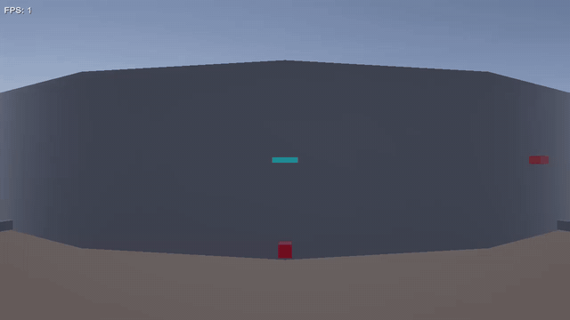
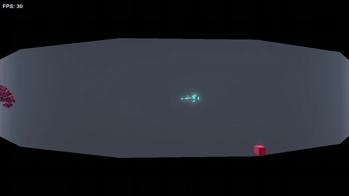

# Cylinder Shooter *(working title)*

A side-view arena shooter on a **wrap-around cylinder**, built in **Unity 6 (URP, C#)**. Fly around a ring-shaped world, cut through enemy formations, and watch every ship you destroy break apart into the cubes it is made of.

This is an open, in-progress portfolio project. I push each feature as it lands, so the history shows how the game and its systems grow.

---

## Progress

### Where it started: greybox prototype
Ship controller, wrap-around world, side-on camera and the first enemies, all as placeholder shapes.

### Where it is now: voxel ships, formations and destruction
The Kestrel player ship, a 25-Chaser wave formation snaking in, swept-collision bullets, and a voxel destruction system: each kill vaporizes in a cyan pulse while the enemy's own cubes are thrown away from the player and fall to the floor.

---

## What this project showcases

### Game feel and tuning
- **Physics-based ship controller** in a fixed timestep: thrust, exponential drag, extra reverse thrust for snappy direction changes, a boost state machine (ready → active → cooldown) with gradual speed recovery, and a smoothed quick-turn.
- **Readable motion:** banking into turns, a camera that leads in the direction of travel, and a FOV widen on boost.
- **Everything is tunable without code:** ship, weapon, enemy, debris and pulse settings all live in ScriptableObject assets.
- **Visual language for fast reading:** cool colours mean the player, warm colours mean enemies; each enemy type has its own silhouette and dominant colour.

### Enemies and encounter design
| Enemy | Behaviour | Status |
|---|---|---|
| **Drifter** | Slow, straight-line; teaches the player to shoot | ✅ |
| **Chaser** | Steers toward the player with a limited turn rate, so it can be outmanoeuvred; avoids the top and bottom edges | ✅ |
| **Gunner** | Keeps its distance and fires patterns | 🔜 planned |

**Formations:** horizontal lines, vertical columns, grids and wave queues that move as a group and **break apart into individual AI** once they get close to the player. Formations always spawn **out of sight**, either off-screen or hidden behind the arena, taking the widest boost FOV into account so nothing pops into view.

### Shaders and VFX
- URP with HDR, bloom and emissive palettes for the neon look.
- **Voxel destruction:** debris is spawned from the model's **actual cube positions and colours**, pushed away from the player, tumbling, falling under gravity and bouncing on the floor. Large models are thinned to a cap with volume-preserving piece sizes.
- **"Vaporize" kill pulse:** flash, expanding ring and spark streaks, automatically sized to each enemy's model.
- Bullet trails tuned so continuous fire reads as separate bolts.
- *In progress:* a custom shockwave ring shader (Shader Graph, then hand-written HLSL).

### Architecture and system design
- **Assembly split:** `Game.Core` holds pure gameplay maths and state with **no MonoBehaviours**, so it is unit tested directly. `Game.Runtime` holds thin Unity components; `Game.Editor` holds tools and scene builders.
- **Cylinder space:** every object is stored as *angle + height*. Wrap-around is free (no teleporting at edges), and shortest-angle maths handles steering, spawning and collision across the 0/2π seam.
- **Composition root:** a single `GameInstaller` wires services into a service locator.
- **Destruction as events:** anything destructible implements `IDestructible`. Effects such as debris and pulses subscribe as independent listeners, so adding a new effect or a new destructible changes nothing else.
- **Performance:** object pools for bullets and enemies; shared particle emitters for debris and pulses, so a kill creates no GameObjects; GPU-instanced debris.
- **Collision that holds up at speed:** swept segment-vs-sphere tests for bullets (no tunnelling), and swept sphere-vs-sphere contact along the curved surface for the player.

**Patterns used:** Observer, Object Pool, Service Locator, Strategy, Flyweight (shared voxel data), Type Object (ScriptableObject profiles), State (boost, player life).

### Testing
EditMode tests for the cylinder maths, ship physics, steering, pooling, collision, debris and pulse maths; PlayMode tests for enemies, player life and contact.

### Voxel art pipeline
Ships are authored as voxel grids and exported as a merged mesh with hidden faces removed, palette textures, an editable `.vox` file, and per-cube data that drives the destruction effect.

---

## Coming next

A **10-minute survival mode** run by a spawn director: enemies arrive in waves of rising and falling intensity, chosen by rules and a threat budget, so **no two runs play the same**. Alongside it: the Gunner, the player's own fiery death explosion with a shockwave, off-screen threat indicators, hit-stop and screen shake, and a playable build.

---

## Running it

1. Clone the repository.
2. Open it with **Unity 6000.3.26f1** (or a newer Unity 6 version).
3. Open a scene in `Assets/Scenes` and press Play.

**Controls:** WASD or arrow keys to move · Space to boost · J or left mouse to fire · gamepad supported.

---

## How this is built

I design the game and its systems, set the architecture and code standards, and review, test and integrate every change.

*Inspired by arcade arena shooters such as Resogun. Nothing is copied from it or any other game.*
