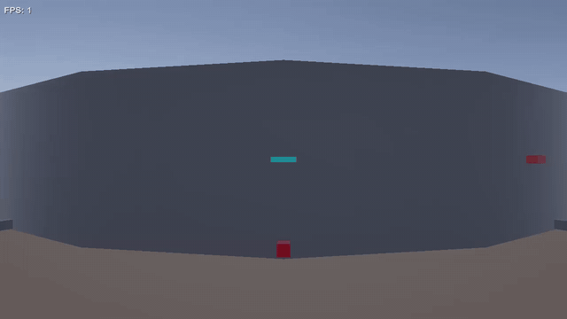
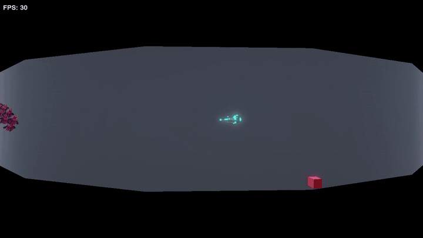
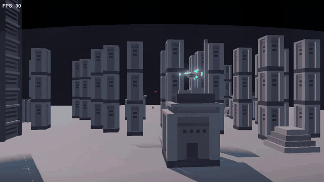

# VoxelCircuit

A side-view arena shooter on a wrap-around cylinder, made in Unity 6 (URP, C#). Ships and enemies are built from cubes, and they break back into cubes when destroyed.

This is an open, in-progress project. I push each feature as I finish it, so the commit history shows how it grows.

## Why I'm making this

I was playing Resogun in two-player recently. It was a lot of fun, and always a challenge to beat. There's a skill you build up over repeated plays, and the difficulty shifts as you go: you can't predict how the enemies will move, but you can sense the intensity building, through the music and everything else happening on screen.

So I took making a game like that as a challenge. Not a clone, but a recreation of that core: a mechanic you get better at through practice, with a real sense of reward when you do.

To get there I'll need to build a lot of my own tools for tuning and testing movement, attacks, animation, VFX and the environment. Building everything up from bare bones is the goal.

## Progress

Where it started: a greybox prototype with the ship controller, the wrap-around world, the side-on camera and the first enemies, all as placeholder shapes.

Then: the Kestrel player ship, a formation of 25 Chasers moving in a wave, and voxel destruction. Each kill gives a short cyan pulse, and the enemy's own cubes are thrown away from the player and fall to the floor.

Currently working on the look and aesthetics of the game. Update 1:

## What's in it so far

### Movement and feel
- Ship controller running in a fixed timestep: thrust, drag, extra thrust when reversing, a boost with a cooldown and a gradual return to normal speed, and a short turn-around instead of an instant flip.
- The ship banks into turns, the camera leads in the direction of travel, and the field of view widens while boosting.
- Ship, weapon, enemy and effect settings are ScriptableObject assets, so tuning happens in the Inspector.

### Enemies
| Enemy | Behaviour |
|---|---|
| Drifter | Slow, flies in a straight line |
| Chaser | Steers toward the player with a limited turn rate, so it can be dodged; turns away from the top and bottom edges |

Formations: horizontal lines, vertical columns, grids and wave queues. They move as a group and break apart into individual AI once they get close to the player. They spawn out of sight, either off-screen or hidden behind the arena.

### Effects
- URP with HDR and bloom, using emissive colours for the neon parts.
- Voxel debris: pieces spawn at the model's actual cube positions and in its colours, then tumble, fall and bounce on the floor. Large models are thinned out to a cap, with bigger pieces to keep the same overall volume.
- Kill pulse: a flash, an expanding ring and a few spark streaks, sized to each enemy automatically.
- In progress: a custom shockwave ring shader, first in Shader Graph and then written by hand in HLSL.

### Architecture
- `Game.Core` holds the gameplay maths and state with no MonoBehaviours, so it can be unit tested directly. `Game.Runtime` holds the Unity components and `Game.Editor` holds tools.
- Every object is stored as an angle and a height on the cylinder. Wrap-around needs no teleporting at the edges, and shortest-angle maths handles steering, spawning and collision across the seam.
- One `GameInstaller` sets up the shared services.
- Anything that can be destroyed implements `IDestructible`. Debris and pulses listen for its event separately, so a new effect or a new destructible doesn't require changes anywhere else.
- Bullets, enemies, debris and pulses are pooled or share particle systems, so a kill doesn't create new GameObjects.

### Voxel models
Ships are made as voxel grids and exported as a merged mesh (with hidden faces removed), palette textures, an editable `.vox` file, and the per-cube data the debris uses.

## A problem I ran into: bullets passing through enemies

Bullets used to check for hits only at their position each frame. A boosted bullet moves at about 80 m/s, which at 30 FPS is about 2.7 m per frame, close to the full width of a Chaser's hit area. So a bullet could be just in front of an enemy on one frame and just behind it on the next, and never register a hit.

I changed the check to test the whole path the bullet travelled during the frame (a segment between its last and current position) against each target, instead of only its end point. There's a test for the exact case: a path that goes straight through a target while both ends of it miss.

## What I've learned so far

- Decide which way models face the camera before making any art. My ship's "up" pointed at the camera, so the side-view models were being shown from above. It was a one-line fix in the code, but I only found it once a real model replaced the placeholder cube.
- Work out effects with numbers before tuning by eye. My bullet trails merged into one long line during continuous fire. The cause was trail length compared with the gap between shots (trail time multiplied by fire rate), and fixing that ratio fixed it.
- Some systems depend on things that aren't obvious. When I hid the arena, the formation spawner stopped working, because the far side of the cylinder was the only place it could spawn enemies out of sight.
- Set up `.gitignore` properly before the first commit. My editor settings ended up in the repository and had to be removed afterwards.

## Next

A 10-minute survival mode, where a spawn director sends enemies in waves of rising and falling intensity, chosen by rules and a budget, so each run plays differently. Also planned: the Gunner enemy, the player's own death explosion, indicators for enemies just off-screen, hit-stop and screen shake, and a playable build.

## Running it

1. Clone the repository.
2. Open it with Unity 6000.3.26f1 or a newer Unity 6 version.
3. Open a scene in `Assets/Scenes` and press Play.

Controls: WASD or arrow keys to move, Space to boost, J or left mouse to fire. Gamepad is supported.

---

*Inspired by arcade arena shooters such as Resogun. Nothing is copied from it or any other game.*
